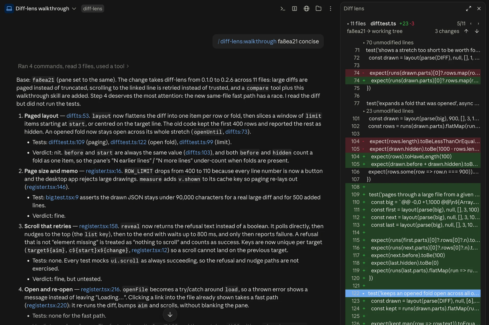

# diff-lens

A mod for Claude Code Desktop. Click a file link in a reply and see **that file's changes against your base branch, scrolled to the line**.



## The problem it solves

When Claude walks you through a pull request, or through what it just changed, every step points at a file and a line. Clicking that link opens the plain file: you land on the right line but cannot see what changed there. The app's Diff view shows what changed, but a link cannot open it, and it cannot be put on a line.

So you read "this line now retries the scroll", click, and then hunt for the same spot in the diff by hand, for every step.

diff-lens joins the two. A link to a changed file opens a pane that shows the file with added and removed lines highlighted, unchanged stretches folded away, and the linked line marked and centred. The explanation and the change it describes sit side by side.

## Install

In a terminal session of Claude Code:

```
/plugin install diff-lens --marketplace mkiselyow/diff-lens
```

Answer `y` to add the marketplace and pick the user scope. The mod then loads in every session started afterwards, including the ones the desktop app starts.

To update later, from a shell:

```
claude plugin marketplace update diff-lens
claude plugin update diff-lens@diff-lens
```

New sessions use the new version.

## Use

- **`/diff-lens:walkthrough`** (or just ask "guide me through this PR") makes Claude explain the change step by step, with a link to the exact changed line at every step. It compares against the repository's default branch; add a branch to compare against another one, for example `/diff-lens:walkthrough part-of-feature-1`.
- **Click a link** to a changed file in any reply, for example `src/app.ts:47`. Links to unchanged files are left to the app, as before.
- **`/diff-lens`** opens the pane with the list of changed files.
- **`/diff-lens src/app.ts:47`** opens one file at a line.
- **`/diff-lens base origin/release`** changes the branch to compare against.
- **`/diff-lens stats`** prints how long git, drawing and opening took in this session, and how each scroll went.

`/diff-lens` appears in the menu once a session is running; `/diff-lens:walkthrough` is there from the start. Claude can also set the base itself: the mod gives it a small `compare` tool, which the walkthrough uses.

In the pane:

| Control | What it does |
|---|---|
| `▸ 12 files` | Show or hide the list of changed files; hover a file for its full path |
| `‹` `›` | Previous or next changed file |
| `↑` `↓` | Previous or next change in this file |
| `origin/main → working tree` | Choose another base branch |
| `▸ 34 unmodified lines` | Unfold that stretch |
| A line number | Put `path:line` into your prompt |

## What it compares

The working tree (committed and uncommitted changes, plus new untracked files) against the merge-base of `HEAD` and the base branch. That is what a pull request's "Files changed" shows, plus whatever is not committed yet.

The base can be any branch, tag or commit. By default it is, in order: the `baseBranch` option, the remote's default branch, then the first of `origin/main`, `origin/master`, `origin/develop`, `origin/release`, `main`, `master` that exists. Change it with `/diff-lens base <ref>`, with `/diff-lens:walkthrough <ref>`, or from the pane (the pane lists the detected branches only).

To compare `feature-123` with `part-of-feature-1`, check out `feature-123` and set the base to `part-of-feature-1`. The compared side is always what you have checked out; two branches that are both not checked out cannot be compared. A remote branch has to be fetched first, and the base is chosen anew in each session.

## What it does on your machine

Everything the mod does, so there are no surprises.

**Programs it starts: `git` only, read-only.** Each command is written out in the source at the place it is run, in the session's folder, with no shell:

- `git rev-parse` (is this a repository, does a branch exist, what is the upstream)
- `git symbolic-ref` (the remote's default branch)
- `git merge-base` (where the branch split from the base)
- `git diff --numstat` and `git diff` (which files changed, and one file's changes)
- `git ls-files --others` (new untracked files)

It never fetches, switches branches, commits or writes files. A base name that starts with `-` is refused, so it cannot be read as an option.

**What it passes to git.** Two kinds of value, and nothing else: the base you or Claude chose (a branch, tag or commit name), and file paths taken from git's own list of changed files. No text from the conversation, no file contents and no URLs are passed. None of the commands contacts a remote: the mod never runs `fetch`, `pull`, `push`, `clone` or `ls-remote`.

**Network: none.** The mod makes no network requests and sends nothing anywhere. It does not call any other tool or MCP server.

**What it reads.** The output of the git commands above, and the file links in Claude's replies. It does not read the contents of your prompts or of Claude's tool calls.

**Claude's replies.** On the desktop app, a reply that links to a changed file is drawn by the mod so that a click on that link reaches it. The wording is not changed; file links are rewritten to absolute `file://` addresses. Links to unchanged files are left to the app.

**Its own pane.** It opens the Diff lens pane and scrolls it.

**Your prompt box.** Clicking a line number in the pane puts `path:line` into the prompt box. The mod never sends a prompt.

**One tool for Claude: `compare`.** The mod registers this tool and answers it itself. It sets or reports the base branch and nothing else.

**Claude's tool calls.** The mod watches Claude's `Edit`, `Write` and `Bash` calls for one reason: to re-read the diff afterwards. It passes every call through unchanged and never blocks or rewrites one.

**Memory only.** Timing numbers for `/diff-lens stats` are kept in memory and are gone when the session ends.

## Limits

- **Desktop first.** Link clicks are handled on Claude Code Desktop only. In the terminal the pane and the commands work, without polish.
- **No syntax colours.** The mod API has no way to draw coloured code with per-line backgrounds, so code is drawn as plain text in the app's text font.
- **Renames show as a removed file and an added file.**
- **The scroll to a line takes about half a second** after the file appears; the app only allows it once the pane has drawn.
- **Large diffs are paged.** The pane draws 110 lines at a time around the changes or the linked line, with "earlier" and "more" controls; the desktop app does not accept much larger drawings.
- **Early-access feature.** Mods are new: the API can change between Claude Code releases, and Anthropic turns the feature on per account. If the install succeeds but links and `/diff-lens` do nothing, mods are probably not enabled for your account yet. Tested with Claude Code 2.1.292 and 2.1.293 on macOS.

## Develop

```
claude plugin validate .
claude plugin test .
claude --plugin-dir .
```

`hooks/diff.ts` (diff parsing and folding) and `hooks/links.ts` (link rewriting) are pure and unit-tested; `hooks/register.tsx` holds the hooks and the pane.

## License

MIT
